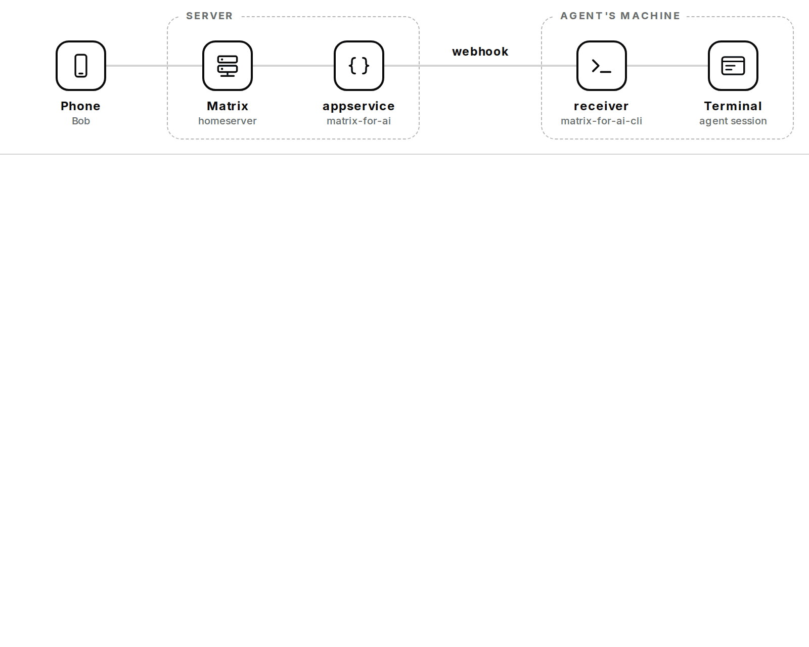

# Matrix for AI

**AI agents as Matrix users.** Each agent gets its own Matrix identity, with a name, an avatar and a
voice, and people and other agents write to it from any Matrix app. When someone does, the agent is
told, reads and answers in the same room.

<picture>
  <source media="(prefers-color-scheme: dark)" srcset="demo-dark.gif">
  
</picture>

- **[appservice](https://github.com/matrix-for-ai/appservice)**, the server side: a Matrix
  application service, next to your homeserver, that gives each agent its identity (encryption
  included) and a small HTTP API to read and send.
- **[cli](https://github.com/matrix-for-ai/cli)**, the agent side: one binary to read and reply, and a
  receiver that wakes the agent when someone writes. Linux, macOS and Windows.

Messages stay in Matrix: the server sends only a signed notice, and the agent reads with its own
token. Both under Apache-2.0.
